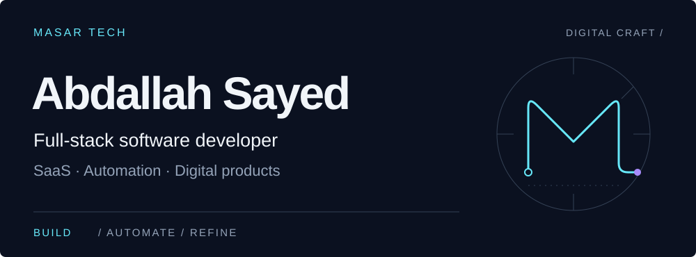
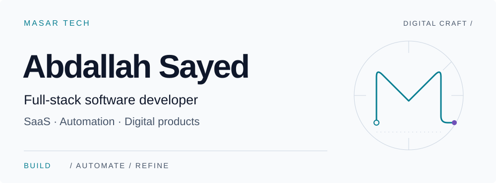

<a href="https://abdallah-sayed-portfolio.vercel.app#gh-dark-mode-only">
  <picture>
    <source media="(max-width: 600px)" srcset="assets/hero-dark-mobile.svg">
    
  </picture>
</a>
<a href="https://abdallah-sayed-portfolio.vercel.app#gh-light-mode-only">
  <picture>
    <source media="(max-width: 600px)" srcset="assets/hero-light-mobile.svg">
    
  </picture>
</a>

# Software that moves work forward.

I’m Abdallah, a full-stack software developer building SaaS tools, business automation, and digital products under **Masar Tech**. My work connects clear interfaces with practical backend systems: quotation workflows, digital menus, storefronts, and Arabic audio tools.

**[View Portfolio ↗︎](https://abdallah-sayed-portfolio.vercel.app)** &nbsp; · &nbsp; [Explore Projects](#selected-work) &nbsp; · &nbsp; [Contact](mailto:abdallahsay10@gmail.com)

## Selected work

### Masar Tech Portfolio

A personal portfolio bringing engineering projects together through case studies and an interactive visual presentation.

**Next.js · TypeScript · React**  
[Source](https://github.com/AbdallahSay/Abdallah-Portfolio-V6-MasarTech-Nextjs) · [Visit portfolio ↗︎](https://abdallah-sayed-portfolio.vercel.app)

### Factory Quote Generator

A quotation workflow for manufacturers: turn sales inputs into Word and PDF documents, store quote records, and queue email and webhook notifications.

**C# · ASP.NET Core · SQL Server · OpenXML · JavaScript**  
[Source](https://github.com/AbdallahSay/factory-quote-generator) · [View live interface ↗︎](https://factory-quote-frontend.vercel.app)

### Digital Menu SaaS

**In development.** A multi-restaurant QR menu project with an Angular server-rendered frontend and a .NET API. The current scope focuses on menu display and tenant-aware data access.

**Angular · TypeScript · ASP.NET Core · EF Core · SQL Server**  
[Source](https://github.com/AbdallahSay/digital-menu-saas)

### Nabra Studio

An Arabic audio workspace with transcription, Egyptian Arabic and Modern Standard Arabic voice generation, and audio export tools.

**React · TypeScript · Express · Gemini API · Vite**  
[Source](https://github.com/AbdallahSay/Nabra) · [View live interface ↗︎](https://nabra-studio.vercel.app)

### WatsStore

A storefront and catalog platform for WhatsApp commerce, with merchant product management, a shopping cart, and order handling.

**Next.js · TypeScript · ASP.NET Core · EF Core**  
[Source](https://github.com/AbdallahSay/watsstore-saas) · [View live interface ↗︎](https://frontend-bay-ten-58.vercel.app)

## Engineering focus

- **Backend & data** — C#, ASP.NET Core, .NET, Entity Framework Core, SQL Server.
- **Web interfaces** — TypeScript, JavaScript, Next.js, React, Angular.
- **Automation & delivery** — document generation, background queues, webhook integrations, GitHub Actions and CI/CD.

## Let’s build something useful.

For a project conversation or engineering collaboration, reach me at **[abdallahsay10@gmail.com](mailto:abdallahsay10@gmail.com)**.

[Explore my portfolio ↗︎](https://abdallah-sayed-portfolio.vercel.app)

---

MASAR / DIGITAL CRAFT — Thoughtful interfaces. Practical systems.
