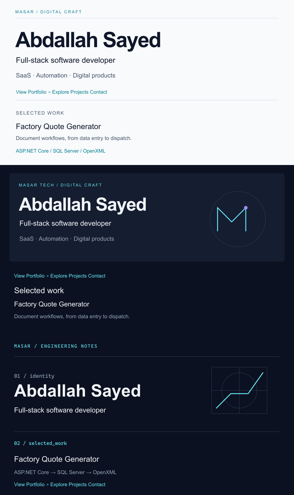

# MASAR / DIGITAL CRAFT — design research

Research date: 20 October 2026. Public profile pages, profile README source and public repository files were inspected. Observations below describe the pages available on that date; design assessments are qualitative, not usability-study results.

## Six real profiles

| Reference | Observed approach | Useful principle | Decision for Masar |
| --- | --- | --- | --- |
| [Sindre Sorhus](https://github.com/sindresorhus) | Very short personal README, direct app and writing links; pinned repositories carry much of the work. | A strong identity does not need a large illustrated biography. | Keep the introduction short and portfolio action early; provide project context rather than statistics. |
| [Anurag Hazra](https://github.com/anuraghazra) | Concise introduction, a small about section, links to work and repository graphics. | Positioning and evidence should be close together. | Put selected work immediately after the introduction. Use native text instead of image-based project cards. |
| [Jonah Lawrence / DenverCoder1](https://github.com/DenverCoder1) | Explicit sections for original projects, contributions, videos, tools and activity. | Clear labels let different audiences scan a long profile. | Borrow the clear section hierarchy. Keep a smaller scope and omit dynamic stats, typing effects and badge walls. |
| [Abhishek Naidu](https://github.com/abhisheknaiidu) | A direct contact invitation, generated activity/time summaries and pinned work. | A visible contact path is useful; activity feeds can dominate the narrative. | Keep a plain email action. Replace feeds with specific product descriptions. |
| [Anton Komarev](https://github.com/antonkomarev) | A conversational introduction links directly to his own products and explains their purpose. | Explain the thing someone can use, not only the tools behind it. | Each project starts with its purpose, followed by technologies and source/live links. No visitor counters. |
| [Lee Robinson](https://github.com/leerob) | Minimal profile copy; website and pinned repositories do the work. No profile README was visible in the inspected overview. | The surrounding GitHub interface already supplies identity and proof. | Avoid rebuilding the entire profile in graphics. One banner is enough. |

## Design-led approaches

The [design-led profile collection](https://github.com/beydemirfurkan/awesome-github-profile) distinguishes approaches including Swiss/brutalist, print/analog, purpose-built and animated SVG. The relevant lesson is to treat typography, grid and accent color as a system, and to understand the maintenance cost of each graphic. Masar uses original static SVG, native text and no graphics service.

The [profile README gallery](https://github.com/abhisheknaiidu/awesome-github-profile-readme) separates minimal, descriptive, code, dynamic and image-led profiles. It demonstrates a wide range of possible information densities. The editorial/descriptive combination best supports a recruiter or potential collaborator who wants to understand the work quickly. These collections informed comparison criteria; no template code or artwork was copied.

## Ten design checks

| Dimension | Applied decision |
| --- | --- |
| Above the fold | Name and role in the hero; short business context and portfolio action directly below. |
| Hierarchy | One identity graphic, one headline, three main content sections; projects are third-level headings. |
| Typography | System sans-serif in SVG; GitHub's own readable typography for the body. Small SVG labels carry no unique essential information. |
| Project presentation | Five public repositories; product explanation, verified stack, source, and a live interface only where checked. |
| Color discipline | Cyan/teal primary accent and a single violet endpoint; neutral backgrounds. |
| Negative space | Broad hero margins and GitHub's native paragraph rhythm; no empty spacer images. |
| Mobile | Single-column project sequence; separate compact hero composition at 600px and below. |
| Themes | Four local assets: light/dark × desktop/mobile. Light fallback if picture sources are unavailable. |
| Accessibility | Identity repeated in meaningful alt text and prose; body links remain selectable and keyboard accessible; static artwork. |
| Differentiation | Original continuous M-shaped route and editorial identity, without contribution gimmicks or invented metrics. |

## Three explorations, before final selection

Individual editable vector previews: [A](concepts/a-editorial-minimal.svg), [B](concepts/b-premium-digital-studio.svg), [C](concepts/c-technical-signature.svg). These are preliminary design studies, not screenshots of GitHub or of project applications.

Scores are art-direction judgments from 1 (weak) to 5 (strong), not measured audience responses.

| Concept | Readability | Originality | Usability | Perceived quality | Tradeoff |
| --- | --- | --- | --- | --- | --- |
| A — Editorial Minimal | 5 | 3 | 5 | 4 | Excellent hierarchy; needs a recognizable signature. |
| B — Premium Digital Studio | 4 | 4 | 4 | 5 | Strong identity; too many dark graphic panels would overwhelm native content. |
| C — Technical / Developer Signature | 4 | 4 | 4 | 4 | Precise diagram language; terminal-like labels can feel impersonal. |

**Selected direction:** A's editorial structure, B's single compact studio banner, and C's geometric precision. The final M-shaped route is newly drawn for this profile. It is a profile motif, not a claim to be an official Masar Tech corporate logo. Artwork is intentionally static.

## GitHub constraints

[GitHub's profile README requirements](https://docs.github.com/en/account-and-profile/how-tos/profile-customization/managing-your-profile-readme) establish the public username repository and root README convention. [GitHub's picture-element guidance](https://docs.github.com/en/get-started/writing-on-github/working-with-advanced-formatting/about-images) informs theme selection. Actual sanitizer output and actual branch rendering are checked separately in the validation report; browser mockups are not treated as the final proof.
