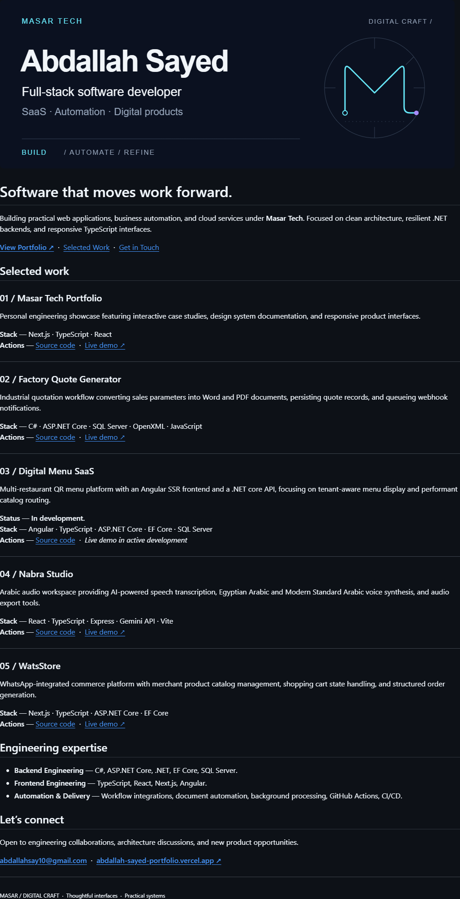

# Final GitHub previews

These are screenshots of the **actual GitHub feature-branch README**, not standalone website mockups. Crops remove surrounding UI; context captures preserve it. The SVG raster previews in this folder are asset proofs, not application screenshots.

| View | Light | Dark |
| --- | --- | --- |
| Desktop · 1440px viewport | [README crop](github-desktop-light.png) · [GitHub context](github-desktop-light-context.png) | [README crop](github-desktop-dark.png) · [GitHub context](github-desktop-dark-context.png) |
| Tablet · 768px viewport | [README crop](github-tablet-light.png) · [GitHub context](github-tablet-light-context.png) | [README crop](github-tablet-dark.png) · [GitHub context](github-tablet-dark-context.png) |
| Mobile · 390px viewport | [README crop](github-mobile-light.png) · [GitHub context](github-mobile-light-context.png) | [README crop](github-mobile-dark.png) · [GitHub context](github-mobile-dark-context.png) |
| Narrow · 320px viewport | [README crop](github-narrow-light.png) | [README crop](github-narrow-dark.png) |
| Explicit site theme, opposite system · desktop | [Light site / dark system](github-desktop-explicit-light.png) | [Dark site / light system](github-desktop-explicit-dark.png) |
| Explicit site theme, opposite system · mobile | [Light site / dark system](github-mobile-explicit-light.png) | [Dark site / light system](github-mobile-explicit-dark.png) |

Explicit-mode cases simulate GitHub's root theme attribute in the test browser. They use the real hosted document and GitHub CSS; no account setting is changed. Details in the [validation report](../VALIDATION_REPORT.md).

## Desktop / dark

## Mobile / light

## Concept explorations

[A — Editorial Minimal](../concepts/a-editorial-minimal.png) · [B — Premium Digital Studio](../concepts/b-premium-digital-studio.png) · [C — Technical / Developer Signature](../concepts/c-technical-signature.png) · [Comparison](../concepts/comparison.png)
